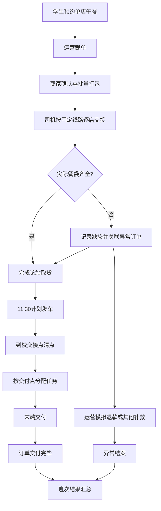

# 资阳校园集运 Demo v0.1 — 产品需求文档（PRD）

**版本**：0.1 / 2026-10-08  
**产品内部代号**：午点通  
**性质**：演示系统，非真实交易平台  
**目标学校**：资阳环境科技职业学院  
**候选取货区域**：梅西商圈、达高商圈  
**决策状态**：固定午餐班次 A1；司机逐店取货 A；学生端与运营端双线兼顾 C。

## 0. 本文档的定位

本 PRD 记录此前已确定的经营流程，用于指导 AI 编程工具开发**可供洽谈商家、校方或校园运营方观看、可重复跑通业务闭环的交互 Demo**。不代表资阳环境科技职业学院已经授权，也不代表已有商家同意入驻。真实交易上线之前，需要核实学校准入、经营主体、平台责任、商户资质、食品安全及温控、资金支付结算、劳动与保险等事项。

## 1. 产品目标与非目标

### P0目标

1. 商家能直观看到自己的门店、午餐订单、批量出餐和司机交接流程。
2. 校园合作方能理解学校端的接收、分拣、配送和异常处理。
3. 运营人员能够演示30笔订单跨商家聚合、逐店取货、11:30固定发车、到校交付及异常处理。
4. 学生端能模拟选店、下单并查看订单状态；后台各模块的数据保持一致。
5. 所有界面在手机和电脑上均可用，并能一键恢复初始演示数据。

### 非目标（本版本坚决不做）

真实支付、商户货款分账、微信登录、手机号验证、真实学生身份信息、校方未许可的校园地图/交付路径、付费推广、推荐算法、优惠券、会员积分、AI派单、库存ERP、多租户SaaS、多校加盟、真实短信推送、车辆GPS跟踪。

## 2. 试点经营参数（均为模拟，可配置）

| 参数 | v0.1模拟值 | 说明 |
|---|---|---|
| 学校 | 资阳环境科技职业学院 | 单校区，未获准入确认 |
| 班次 | 午餐第一班 B001 | 初期每日一个午餐班次 |
| 预订开启 | 前一晚可预订 | 真实开放日待定 |
| 截单时间 | 10:40 | 截单后不可正常新增订单 |
| 计划取货 | 11:05 / 11:15 / 11:25 | A、B、C店时间均待实测 |
| 固定发车 | 11:30 | 指城区最后取货点离开时间 |
| 预计交付 | 12:10–12:30 | 须结合实际交通、分拣及食品品质验证 |
| 初始商家 | 3家虚拟商户 | 梅西2家，达高1家，不冒用真实店铺 |
| 初始订单 | 30笔模拟订单 | 34个餐袋 |
| 交付点 | 指定交接点 A/B（演示） | 校方批准前不默认能入校/到宿舍 |
| 收费 | 客单模拟值、配送费2.5元、佣金8% | 仅作模型假设；不收款 |
| 成本 | 每单变动成本2.05元，单班固定90元 | 仅作模型假设；排除其他支出 |

## 3. 用户角色和页面

**角色一：学生（移动H5）**
- 首页：学校、午餐班次、截单与送达窗口、商家列表。
- 门店详情：菜品、价格、说明、商品加减、购物车。
- 订单确认：只允许选择一家店；选择可配置的模拟交接点；看到配送费用；点击模拟支付/下单。
- 我的订单：订单编号、商品、时间、状态、模拟金额；状态实时跟随后台变化。
- 防错规则：本班截单后不可提交订单，不允许超过班次容量。

**角色二：商家（移动/平板H5）**
- 本班看板：订单数、餐品汇总、待出餐份数、计划取货时间。
- 接单：截单后确认本店订单；生产清单按SKU汇总。
- 打包：按订单标识生成餐袋；区分“已打包待取”和“已被司机交接”。
- 正式版本补充：部分打包、拒单/售罄、打包标签打印、交接详情与变更审核。

**角色三：城区司机（移动H5）**
- 固定路线 R001，展示沿途商家、计划到店时刻与取货餐袋数。
- 逐店完成交接，必须校验前一站，记录计划数量和实际数量。
- 在测试中可人为制造缺袋，生成异常记录，并确保未装车订单不变更为运输中。
- 所有站点均有交接结果后允许发车（特殊异常另行处理）。

**角色四：校园负责人/配送员（移动H5）**
- 到校清点：仅接收实际被司机取走的餐袋。
- 分拣：按经确认许可的交付点分组。
- 配送任务：分配、标记配送中、完成交付。
- 重要约束：学校入校许可、宿舍交付权限、实际场地未经核实，不能擅自假定。

**角色五：平台运营（Web）**
- 运营首页：班次时间、订单/餐袋/异常数量、关键操作指引。
- 班次控制台：截单、监控商家出餐及各站点交接、固定发车、结束班次。
- 异常中心：记录商家迟到/漏餐/运输差异，对异常执行有痕迹的模拟处置。
- 模拟财务：商品GMV、佣金、配送费、成本和班次贡献；明确不是净利润。
- 演示重置：恢复30笔订单、34个餐袋与全部初始状态。

## 4. 主业务流程

### 状态必须分离

- **班次状态**：`open → cutoff → collecting → transit → campus → delivering → finished`。
- **餐袋状态**：`pending → ready → picked → campus → out → delivered`，异常分支 `missing → refunded`（仅为测试流程）。
- **订单状态**：按该订单所关联的餐袋和商家接单状态推导，不能在班次发车时无条件把全部订单改成运输中。
- **异常状态**：`open → resolved`，保留发生时间、商家、订单、餐袋、处理人及处理结论。

对于多餐袋订单，前端不能因为其中一个餐袋已送达就标记全单已交付。正式版应进一步定义部分退款、补送、改班和订单赔付状态。

## 5. 核心数据实体

- `School(id,name)`：学校名称。
- `DeliveryPoint(id,schoolId,name,status)`：交付点与校方许可状态。
- `Merchant(id,name,zone,address,capacity,status)`：商家和真实位置；演示使用假店。
- `Product(id,merchantId,name,price,active)`：商品。
- `Batch(id,schoolId,cutoffAt,departAt,deliveryStart,deliveryEnd,capacity,status)`：班次。
- `Order(id,batchId,merchantId,pointId,items,amount,acceptedAt,status)`：订单。
- `OrderItem(orderId,productId,quantity,unitPrice)`：明细。
- `Parcel(id,orderId,merchantId,status)`：物理餐袋。
- `PickupRoute(id,batchId,stops)`：城区取货线路。
- `PickupStop(id,routeId,merchantId,sequence,plannedPickupAt)`：取货站。
- `HandoffRecord(id,stopId,actor,plannedCount,actualCount,time)`：交接流水。
- `DeliveryTask(id,pointId,assignedActor,status)`：末端任务。
- `ExceptionRecord(id,orderId,parcelId,type,status,resolution)`：异常。
- `CostRecord(id,batchId,category,amount)`：班次成本。
- `AuditEvent(id,actor,time,action,details)`：操作审计。

本地静态演示的 `engine.js` 已包含其中的简化实现，正式 Demo 用后端模型替代，不应直接把页面状态作为权威数据源。

## 6. 数据与系统要求

1. 演示环境可以使用“角色切换”，但必须在 UI 上清楚标明不是真实登录；不能将其误用于正式上线。
2. 正式 Demo v0.1 在客户端之外加 FastAPI 后端，业务规则、权限和校验置于后端。前端通过API读取同一份数据。
3. 首版后端使用 SQLite 便于 Windows 本地启动，SQLAlchemy + Alembic 管理数据；后续可迁至 PostgreSQL。
4. 所有状态操作必须进行服务器端校验；应支持必要的幂等控制、数据库事务与审计日志，杜绝重复领取、重复发车、重复退款。
5. 数据种子可生成30笔订单、34袋；可重置。每次测试重新回到一致的初始状态。
6. 桌面和手机响应式界面，中文用户界面。
7. 不访问真实支付、微信、学校、商家任何线上接口。

## 7. 演示验收脚本

### A. 正常流程

- 初始30单、34袋，班次状态开放预订。
- 学生端增加1单，数字同步变化。
- 运营确认截单，新订单按钮禁用，后台拒绝过期下单。
- 3家店分别接单和打包，司机按A→B→C取货。
- 11:30模拟发车，校园端收到已实装餐袋，末端配送完成。
- 本班结束，所有订单在所有端显示一致。

### B. 缺袋流程

- 按正常流程做到司机取货，但在C店模拟少取1袋。
- 司机实际取货数比计划少1，后台出现开放异常。
- 发车后，该异常餐袋/订单仍保持异常，不能显示运输中或已送达。
- 正常餐袋完成校园交付。
- 运营处理该异常，模拟退款、留下审计记录；班次才能结案。

### C. 非法动作阻止

- 未截单不能进行取货。
- 商家未接单不能确认全部打包。
- 跳过前一站不能确认后续站点。
- 同一个站点不能重复确认取货。
- 未发车不能到校接收，未接收不能分配任务。
- 已处理异常不能重复模拟退款。
- 商家A不可通过真实后端权限读写商家B的数据；角色切换演示机制不得成为生产权限。

## 8. 从现有静态演示到正式 Demo 的迁移路线

**Stage 0**：先运行、阅读现有代码和本 PRD，列出现有功能与缺口；保持可运行。

**Stage 1**：FastAPI + SQLite + SQLAlchemy + Alembic 后端、结构化模型、固定种子、单元测试，原型交互通过API持久化；页面继续可点击。

**Stage 2**：前端使用 React + TypeScript + Vite，保留当前布局视觉风格和四类操作端；用统一API替代浏览器本地状态。

**Stage 3**：完善逐单/逐袋交接、异常责任、权限隔离、审计记录、班次财务结算展示。

**Stage 4**：完善复合测试、Windows一键启动脚本、演示脚本、README与可复现验收报告。

注意：Stage 0-4 是**正式后端 Demo 的迭代路线**，不是要求用户在看到界面之前先做完全部项目。用户当前已获得可本地打开的静态交互原型。

## 9. 必须通过线下实测才能修改的参数

- 资阳环境科技职业学院的真实校园准入方式、校园交接点、楼栋/宿舍配送权限
- 目标商家的具体门店名称、地址、资质、出餐能力及菜单授权
- 梅西和达高间实际取货绕行、停车、进店交接时间
- 线路真实发车时间与到校时长、学生下课和用餐时间
- 餐品运输适配性、温控、包装、司机报价、学生配送成本
- 正式交易主体、支付/分账、商家佣金及售后责任

以上信息在确认前均必须保持“待验证”标识，不得写成已获许可的事实。
